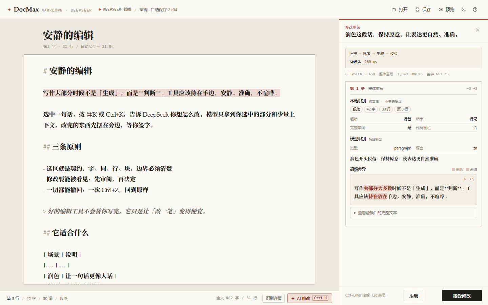
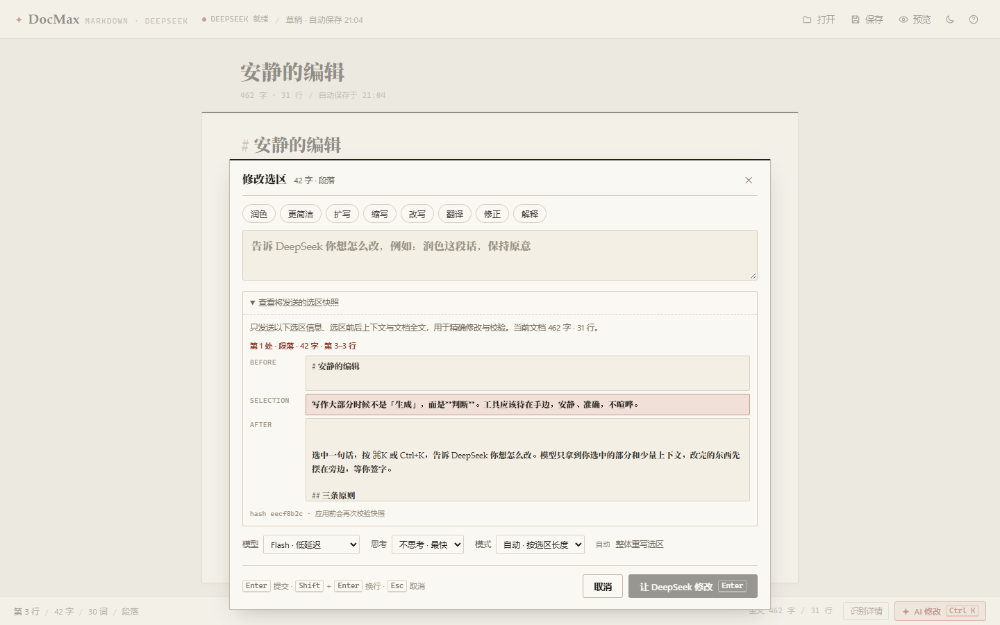
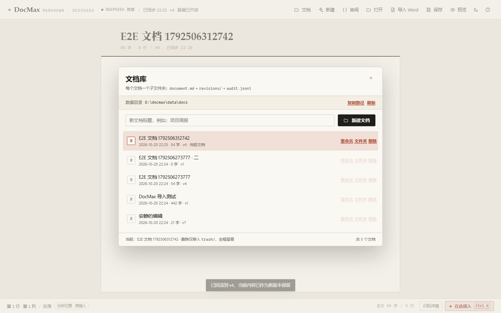
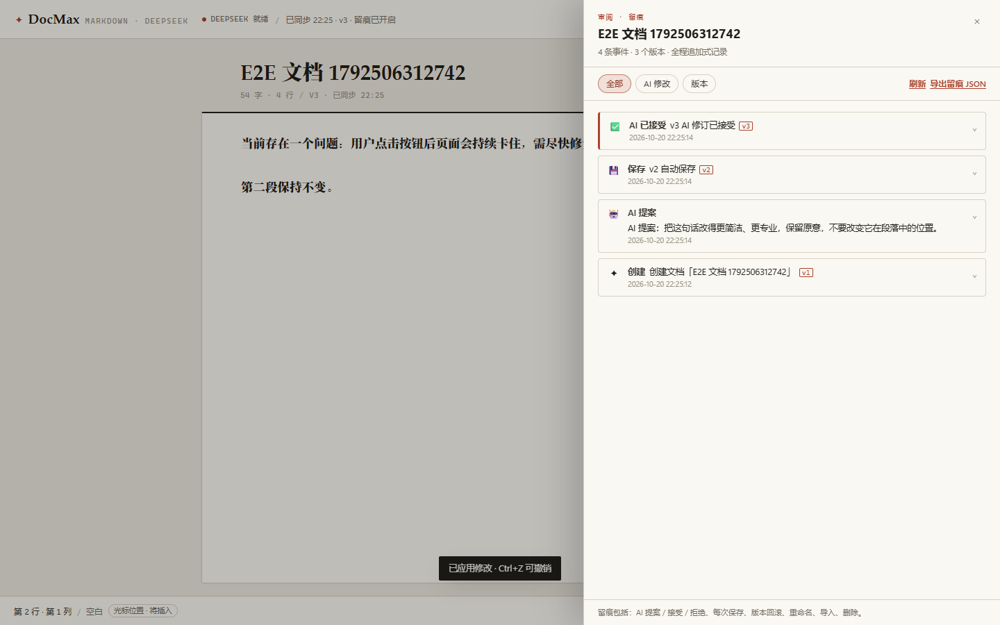
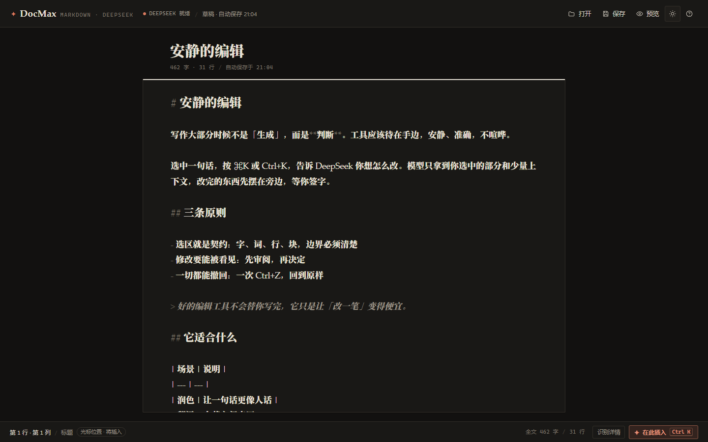
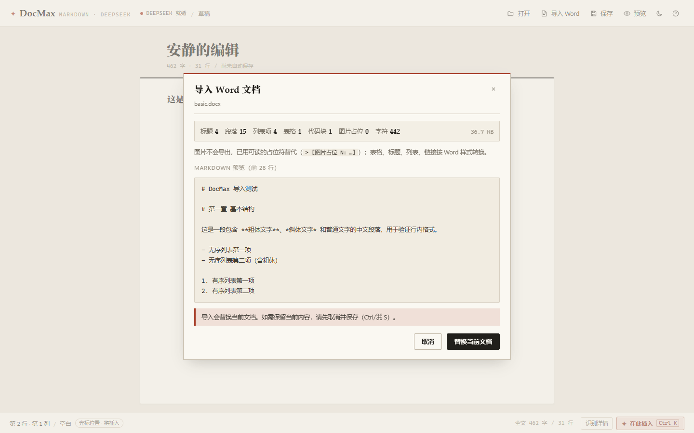

# DocMax

**把 DeepSeek 变成「只改你选中那段字」的编辑引擎。**
一个本地运行的极简 Markdown 编辑器：选中文字 → 说一句怎么改 → 模型流式返回 → 词级差异审阅 → 接受（一步撤销）/ 放弃。

[项目主页（HTML）](https://lizhong0525.github.io/docmax/) · [设计说明](DESIGN.md) · [验证报告](docs/ui-verification.md) · [Word 导入](#从-word-导入docx--markdown)




---

## 它解决什么问题

市面上的「AI 写作」大多像聊天：生成整段文字，再让你自己复制粘贴。DocMax 反过来——**编辑器的原子操作是「替换一个精确选区」**，并且把「模型可能改错地方」这件事当成一等工程问题来解：

| 风险 | DocMax 的做法 |
| --- | --- |
| 模型输出跑偏、带前言/围栏/截断 | 哨兵协议 + 流式容错解析 + `finish_reason` 截断检测 |
| 模型改了选区外的内容 | 默认**整选区替换**；surgical 模式锚点必须唯一命中；应用前逐字校验快照 |
| 模型思考期间用户继续编辑导致错位 | 选区快照 = 偏移 + 原文 + 指纹 + 前后文，应用前二次比对 |
| 模型把「上下文」一起吐回来造成重复 | 上下文泄漏校验（≥40 字符前后文出现在结果里 → error） |
| 结构被破坏（代码围栏、表格、标题标记） | Markdown 结构校验 + 分级警告 + 一次自动修复重试 |
| 审阅重、撤销难 | 提案只进 UI，不进文档；接受时**单个 CodeMirror transaction**，一次 Ctrl+Z 回滚 |

## 功能

**编辑器**
- CodeMirror 6：Markdown 语法高亮、真实选区模型、原生撤销/重做、CJK 舒适排版
- 纸感浅色 / 深色双主题，桌面与窄屏自适应
- 本地文件打开 / 保存（File System Access API，Chrome/Edge；不支持时退化为上传/下载）
- localStorage 自动保存，Markdown 预览（marked + DOMPurify）

**模型选区编辑**
- `Ctrl/⌘ K` 指令条：润色 / 更简洁 / 扩写 / 缩写 / 改写 / 翻译 / 修正 / 解释，也可自由输入
- **9 种系统内置提示词模式**：默认编辑、结构重写·括号补全、精简、扩写、正式/学术、通俗、最小校对、结构化整理、翻译中英；指令可留空
- **不限制输出长度**：不发送 `max_tokens`，长文不会被人为截断；长任务超时默认 10 分钟
- 三种编辑模式：**整体重写**（默认，≤4000 字）、**局部精准修改**（长选区/机械替换）、**光标插入**
- 「解释」模式只回答关于选区的问题，不修改文档
- 流式审阅：阶段（连接/思考/生成/校验/修复）、模型识别结果、思考过程（可折叠）、token 与首字延迟
- 词级 diff（CJK 友好）+ 分级警告；红色警告（截断/上下文泄漏）需二次确认
- 接受、拒绝、重新生成、过期快照保护；接受后可一步撤销

**文档库与留痕（v0.4.0 新增）**
- **新建文档**：文档库一键新建；每个文档独立的磁盘子文件夹
- 文档库：打开 / 切换 / 重命名 / 删除（移入 `trash/` 回收站）/ 在资源管理器打开文件夹
- 自动保存到文档库（1.2 秒防抖），每次内容变化生成不可变版本快照（`revisions/`）
- **审阅 / 留痕**：追加式 `audit.jsonl` 记录创建、每次保存、AI 提案 / 接受 / 拒绝、重命名、导入、回滚；可查看版本 diff、一键回滚、导出留痕 JSON
- AI 提案即使被拒绝也会留痕；删除文档只移入回收站，历史与留痕全部保留

**Word 导入**
- 顶栏「导入 Word」：`.docx` → 标准 Markdown，语义保留标题/列表/表格/链接/引用/代码块
- 图片不导出，替换为可读占位符，避免 Markdown 体积爆炸
- 转换前展示摘要与预览，确认后创建为新文档（旧文档完整保留在文档库）
- 同样的转换能力可脱离界面使用：`pnpm docx2md` CLI 或 `POST /api/import/docx`

**工程与质量**
- 前后端共享纯 TS 核心（解析、匹配、校验、diff），可单测、可替换
- 服务端唯一持有 API Key；文档仅发送给 DeepSeek
- 269 个单元测试、30 例真实模型评测、13 个 Playwright E2E、完整验证报告

## 截图

| | |
| --- | --- |
|  |  |
| **选区识别 + 指令条**：块类型、词边界、payload 快照 | **审阅面板**：本地识别、模型识别、词级 diff、token |
|  |  |
| **文档库**：每个文档一个子文件夹，新建 / 切换 / 重命名 / 删除 | **审阅 · 留痕**：AI 提案 / 接受 / 保存 / 版本时间线 |
|  |  |
| **深色模式**：纸感深色 + 朱砂强调色 | **Word 导入**：摘要、预览、创建新文档 |

## 快速开始

需要 **Node.js ≥ 22**（开发时使用 Node 24 验证）与一个 DeepSeek API Key（[获取地址](https://platform.deepseek.com/api_keys)）。

```bash
git clone https://github.com/lizhong0525/docmax.git
cd docmax
pnpm install                 # 或 npm install
cp .env.example .env         # 填入 DEEPSEEK_API_KEY
pnpm dev                     # http://127.0.0.1:5199
```

`.env` 配置：

```ini
DEEPSEEK_API_KEY=sk-...                     # 必填
DEEPSEEK_BASE_URL=https://api.deepseek.com  # 可选（OpenAI 兼容网关）
PORT=5199                                   # 可选
DOCMAX_MODEL=deepseek-flash                 # 可选：deepseek-flash | deepseek-v4-pro
DOCMAX_MAX_DOCX_BYTES=26214400              # 可选：docx 大小上限（字节）
DOCMAX_TIMEOUT_MS=600000                    # 可选：单次生成超时（默认 10 分钟）
DOCMAX_DATA_DIR=D:\DocMaxData               # 可选：文档库根目录（默认开发版 ./data，安装版「文档\DocMax」）
```

生产运行：

```bash
pnpm build
pnpm start                   # 一个进程同时服务 dist/ 与 API
```

### 桌面快速启动（Windows）

不想每次敲命令？一次性创建桌面快捷方式：

```powershell
powershell -NoProfile -ExecutionPolicy Bypass -File scripts\create-desktop-shortcut.ps1
```

之后双击桌面上的 **DocMax** 即可：

- 本地服务已在运行 → 直接打开 <http://127.0.0.1:5199>
- 未运行 → 后台启动（优先使用已构建的 `dist/`，缺失时退回开发模式），就绪后自动打开浏览器
- 全程无控制台窗口；服务日志在 `.dev/server.log`
- 停止服务：`powershell -NoProfile -ExecutionPolicy Bypass -File scripts\stop-docmax.ps1`

说明：快捷方式指向 `scripts/launch-docmax.vbs`（隐藏窗口启动 `scripts/start-docmax.ps1`），图标为 `assets/docmax.ico`（可用 `python scripts/make-icon.py` 重新生成）。移动项目目录后重新运行一次创建脚本即可。开发时若需要热更新请直接用 `pnpm dev`；快捷方式使用生产构建，代码更新后记得 `pnpm build`。

### Windows 安装包（自包含）

如果要分享给没有 Node.js 环境的人，直接构建安装包：

```powershell
powershell -NoProfile -ExecutionPolicy Bypass -File installer\build.ps1
```

产物：`installer\dist\DocMax-Setup.exe`（约 **23 MB**，内置 Node 运行时，无需另装 Node 或依赖）。

已构建版本可从 [GitHub Releases](https://github.com/lizhong0525/docmax/releases/latest) 下载（`DocMax-Setup.exe`）。

安装包行为：

- 按当前用户安装到 `%LOCALAPPDATA%\DocMax`，**无需管理员权限**；
- 安装界面可填写 DeepSeek API Key（留空也能稍后在安装目录的 `.env` 中配置）；
- 创建桌面 / 开始菜单快捷方式（无控制台窗口启动）；
- 检测到 Word 时自动安装 Word 加载项（重启 Word 后出现 DocMax 选项卡）；
- 在 Windows「设置 → 应用」中提供标准卸载；卸载时会把 `.env` 备份到 `%USERPROFILE%\DocMax.env.bak`，**文档库（`文档\DocMax`）会保留**。

说明：安装包未做代码签名，Windows SmartScreen 可能提示，选择「更多信息 → 仍要运行」即可；安装包内为生产构建，代码更新后重新运行构建脚本生成新包。

> 没有 API Key 也能打开编辑器、写 Markdown、导入 Word；AI 修改会提示配置 Key。

## 使用

选中任意文字后：

- 点击浮出的「✦ AI 修改」，或按 `Ctrl/⌘ K` 打开指令条
- 输入指令（`Enter` 提交，`Shift+Enter` 换行），或用快捷标签；也可以只选一个「提示词模式」直接提交
- 等待流式生成 → 在右侧审阅面板查看模型识别、diff 与警告
- `Ctrl/⌘ Enter` 接受（一次性应用），`Esc` 放弃
- 接受后按 `Ctrl/⌘ Z`，**一步撤销**回到修改前
- 所有编辑自动保存到文档库（每个文档一个子文件夹）；顶栏「审阅」可查看全程留痕、版本 diff 与回滚

常用快捷键：

| 快捷键 | 功能 |
| --- | --- |
| `Ctrl/⌘ K` | 打开指令条 / 修改选区 |
| `Ctrl/⌘ Enter` | 接受当前提案 |
| `Esc` | 取消 / 关闭浮层 / 中止生成 |
| `Ctrl/⌘ Z` | 撤销（含一次 AI 应用） |
| `Ctrl/⌘ Shift Z` | 重做 |
| `Ctrl/⌘ O` | 打开 Markdown 文件 |
| `Ctrl/⌘ S` / `Ctrl/⌘ Shift S` | 保存 / 另存为 |
| `Ctrl/⌘ P` | 切换 Markdown 预览 |
| `Ctrl/⌘ /` | 快捷键帮助 |

### 提示词模式（系统内置）

指令条里除了自由指令与快捷标签，还有一个「提示词」下拉。它改的是**系统级任务设定**，决定模型「以什么方式」完成修改：

| 模式 | 用途 |
| --- | --- |
| 默认编辑 | 按指令直接改；保留原文信息、语气与结构 |
| **结构重写 · 括号补全** | 按原文结构骨架重写；信息缺失处不编造，用 `（需补充：…）` 标注 |
| 精简压缩 | 删冗余、去口水话，保留事实、结论与结构 |
| 扩写补全 | 补充细节、解释与过渡；不编造数据 |
| 正式 / 学术 | 正式、专业、克制的书面表达 |
| 通俗解释 | 更口语、易懂地重写，保留关键信息 |
| 最小校对 | 只修错别字、标点、语法；不润色、不改结构 |
| 结构化整理 | 整理成清晰的标题 / 列表 / 表格；不增删信息 |
| 翻译成英文 / 中文 | 自然翻译，保留 Markdown 结构、术语与数字 |

几点行为：

- 选了**非默认模式后，指令可以留空**，直接使用该模式的默认任务；也可以继续补充自己的要求；
- 「结构重写」专治原文写到一半、信息不全：保留原有标题/列表/表格结构，缺失处写成 `（需补充：具体缺什么）`，不会编造事实；
- **不限制输出长度**：服务端不发送 `max_tokens`，长文不会被 1K/2K 的人为上限截断；生成超时默认 10 分钟，可用 `DOCMAX_TIMEOUT_MS` 调整；
- 解释模式不使用提示词模式，只回答问题。

## 文档库与审阅（全程留痕）

顶栏新增三个入口：**文档**（文档库）、**新建**、**审阅**。

### 每个文档一个子文件夹

文档库保存在磁盘上，可直接用资源管理器查看/备份：

```
<数据目录>/
  docs/
    doc-20261020-221500-ab12cd/     ← 每个文档独立子文件夹
      document.md                   当前内容
      meta.json                     标题 / 时间 / 版本数 / 字符数 / hash
      revisions/000001.md …         不可变版本快照（每次内容变化新增）
      revisions.json                版本元数据
      audit.jsonl                   追加式留痕（永不修改历史行）
  trash/                            删除的文档（整文件夹移入，留痕保留）
```

- 数据目录：开发模式为项目下 `data/`；安装版为 `%USERPROFILE%\Documents\DocMax`；可用 `DOCMAX_DATA_DIR` 覆盖；
- 文档库支持新建、打开、切换、重命名、删除（移入 `trash/`）、「文件夹」按钮直接在资源管理器打开；
- 每个文档的标题、版本、留痕互相隔离，删除/移动项目不影响其他文档。

### 新建 / 自动保存 / 版本

- 顶栏「新建」或文档库「新建文档」创建空白文档并立即切换；
- 编辑后 **1.2 秒防抖自动保存**到文档库；每次内容变化产生一个版本；相同内容不重复建版本；
- `Ctrl/⌘ S` 手动保存（生成新版本；若绑定了本地文件则同时写回文件）；
- 导入 `.docx` / 打开本地 `.md` 会**创建为新文档**，原文档完整保留。

### 审阅与留痕

点顶栏「审阅」打开时间线：

- 留痕事件：创建、每次保存、AI 提案、AI 接受、AI 拒绝、重命名、导入、回滚、删除；
- **AI 提案即使被拒绝也记录**（指令、模型、提示词模式、选区前后文本、警告）；
- 事件按版本查看前后 diff；可一键回滚到任意版本（回滚本身也生成新版本并留痕，不丢失当前内容）；
- 「导出留痕 JSON」可导出该文档完整事件与版本元数据；
- 删除只移入 `trash/`，不会物理删除任何版本/留痕。

## 从 Word 导入（docx → Markdown）

Word 文档不想手动重排？点顶栏 **「导入 Word」**，选择 `.docx`，DocMax 会先在本地转换：

- **标题 / 段落 / 粗体 / 斜体 / 列表 / 表格 / 链接 / 引用 / 代码块**按 Word 样式语义转换为标准 Markdown；
- **图片不导出**：转换为可读占位符 `> [图片占位 N：image/png，未导出图片文件]`（避免 base64 让 md 体积爆炸），转换前可预览；
- 转换完成后先展示摘要与 Markdown 预览，确认后**创建为新文档**（旧文档完整保留在文档库）；
- 文件大小上限默认 25 MB，可用 `DOCMAX_MAX_DOCX_BYTES` 调整。

同样的转换能力也可以脱离界面直接用命令行：

```bash
# 输出到 stdout
pnpm docx2md 文档.docx
# 写入文件
pnpm docx2md 文档.docx -o 文档.md
# 输出 JSON（含统计与警告）
pnpm docx2md 文档.docx --json
```

或者作为本地 HTTP API：

```bash
curl -X POST "http://127.0.0.1:5199/api/import/docx?name=a.docx" \
  -H "Content-Type: application/vnd.openxmlformats-officedocument.wordprocessingml.document" \
  --data-binary @a.docx
```

已知限制：Word 里纯手工排版的“伪标题”（未使用标题样式）会按普通段落处理；合并单元格会被展平；页眉页脚、批注、修订痕迹不导出；表格表头仅在 Word 标记了“标题行重复”时识别，否则生成空表头以保留全部数据行。

## Word 插件（在 Word 里直接改字）

不用复制粘贴：安装一个 Word 加载项后，在 Word 里选中文字即可让 DocMax 改写。安装无需管理员权限：

```powershell
powershell -NoProfile -ExecutionPolicy Bypass -File word-addin\install.ps1
```

安装后**重启 Word**，功能区会出现「DocMax」选项卡：

| 按钮 | 行为 |
| --- | --- |
| **AI 改写…** | 输入任意指令（润色 / 扩写 / 翻译 / 改成更正式…），预览后替换选区 |
| **结构重写** | 按原文结构重写；信息缺失处用 `（需补充：…）` 标注，不编造 |
| **润色** | 一键润色选中文字（保持原意） |
| **解释** | 只解释含义/结构/作用，不修改原文 |
| **检查服务** / **打开 DocMax 编辑器** | 查看/启动本地服务，或打开完整 Markdown 编辑器 |

行为与安全：

- 修改结果先在确认框里预览，**确认后才替换选区**；应用后可 `Ctrl+Z` 撤销；
- 只处理选中的范围（没选中会提示）；保留段落/单元格结束符，避免与下一段粘连；
- 本地服务未启动时，插件会自动后台启动 DocMax（不需要你手动开终端）；
- 文档内容只发送到本机 `127.0.0.1:5199`，再由本机服务转发 DeepSeek；插件本身没有外部网络访问；
- 卸载：`powershell -NoProfile -ExecutionPolicy Bypass -File word-addin\uninstall.ps1`（重启 Word 生效）。

实现方式：Word VBA 模板加载项（`.dotm`，复制到 Word 的 `STARTUP` 目录即可安装）+ 自定义功能区（Ribbon customUI）；每次操作调用本机 `POST /api/word/edit`，该接口复用编辑器同一套「选区识别 → 提示词模式 → DeepSeek → 校验 → 自动修复」流水线，只是把流式结果聚合成一次性 JSON 返回给 Word。构建/自检脚本在 [`word-addin`](word-addin)。

限制：仅 Windows 桌面版 Word（Office 2016+ / Microsoft 365）；需要允许宏（STARTUP 模板通常自动加载；若功能区未出现，请检查 Word「选项 → 信任中心 → 宏设置」）；不支持 Word Online。

## 工程方法（简要）

```
浏览器（React 19 + CodeMirror 6）
   │  POST /api/edit（SSE，本地回环）
   ▼
Node 单进程（Express 5 + Vite middleware）
   ├─ 请求/选区快照校验（偏移 + 原文 + 指纹 + 前后文）
   ├─ 本地确定性选区识别（块类型/围栏/词边界/标记平衡）
   ├─ 提示词 + 每请求随机哨兵标记
   ├─ DeepSeek 流式调用（content / reasoning_content / usage / finish_reason）
   ├─ 流式容错解析 → 分层锚点匹配 → 结构/泄漏校验 → 失败自动修复一次
   └─ 已校验提案（proposal）→ 前端词级 diff → 用户接受/拒绝
```

几个关键取舍（完整理由与实测数据见 [DESIGN.md](DESIGN.md)）：

- **默认整选区替换，而不是让模型找位置**：没有锚点幻觉；长选区才切换为带唯一性约束的 FIND/REPLACE 锚点补丁。
- **模型输出是不可信输入**：只有通过解析 + 校验的内容才会变成提案；截断内容绝不静默应用。
- **识别分两层**：本地确定性识别（立即可靠）+ 模型结构化识别（`kind/language/summary`），都展示给你看。
- **流式只进 UI，不进文档**：避免撤销历史被 token 弄脏，接受时一次性提交事务。
- **本地 Web 应用**：一条命令启动、API Key 留服务端、可读写本地文件，也能用真实浏览器做端到端验证。

## 验证结果

| 项目 | 结果 |
| --- | --- |
| 核心单元测试 | **269 / 269 通过**（原有解析/匹配/选区/diff/docx + 提示词模式、空指令回退、请求体无 `max_tokens` + 文档库/版本/留痕 8 项） |
| 真实模型评测 | **30 / 30 通过**（rewrite / surgical / insert / ask；≥4000 字长选区、注入文本、表格/代码/frontmatter、翻译/扩缩写…） |
| 应用安全性 | **选区外零改动率 100%**，提案可应用率 100%，结构校验 100% |
| 延迟 | 总延迟 avg **1.05s** / p50 849ms / p95 2.92s；首字 avg 780ms |
| 成本 | 30 次真实编辑共约 **$0.0038**（缓存命中时，约 $0.00013/次） |
| 长输出 / 无限制 | 单次实测 **2352 字**、`completionTokens=1367`（旧 1024 token 上限会截断），`truncated=false` |
| 结构重写模式 | 真实模型输出保留标题/列表/表格结构，并为 4 处缺口生成 `（需补充：…）`，未编造事实 |
| 文档库 / 留痕 | 每个文档独立子文件夹；保存生成不可变版本；相同内容不重复建版本；AI 提案/接受/拒绝、重命名、回滚、删除全部追加式留痕；删除移入 `trash/` 保留历史 |
| `E2E（真实 Chrome + 真实 DeepSeek）` | **13 / 13 通过**：接受/撤销/拒绝/插入/预览/窄屏 + 提示词模式 + **新建文档/自动保存/审阅留痕/版本 diff/回滚/切回文档** + docx 导入 |
| Word 加载项 | 构建/安装成功；VBA 自检 + **隐藏 Word 文档中的选区替换**自检通过（真实 DeepSeek，0.7–1.1s）；新增「结构重写」按钮 |
| UI 验收 | **52 / 52 断言通过**，20 张截图，0 console error / 0 pageerror |

完整数据与可复跑命令见 [评测报告](.research/eval-report.md)、[验证报告](.research/verification-report.md)、[UI 验收报告](docs/ui-verification.md)。

```powershell
# 单元测试
node node_modules/vitest/vitest.mjs run
# 真实模型评测（需服务已启动，约 40–60s，成本约 $0.004）
node node_modules/tsx/dist/cli.mjs scripts/eval.ts
# Playwright E2E（需服务已启动）
node node_modules/@playwright/test/cli.js test
```

## 命令

| 命令 | 说明 |
| --- | --- |
| `pnpm dev` | 开发模式（Vite HMR + API，单端口） |
| `pnpm start` | 生产模式（需先 `pnpm build`） |
| `pnpm typecheck` | 前端 + 服务端 TypeScript 检查 |
| `pnpm test` | vitest 单元测试 |
| `pnpm eval` | 真实 DeepSeek 端到端评测（需服务已启动） |
| `pnpm docx2md` | 命令行 docx → Markdown 转换（不经过模型） |
| `pnpm e2e` | Playwright 浏览器端到端测试（需服务已启动） |
| `pnpm landing` | 由 README 生成 HTML 项目主页（`docs/index.html`） |
| `pnpm word:install` | 构建并安装 Word 加载项（复制到 Word STARTUP，无需管理员） |
| `pnpm word:build` | 仅构建 Word 加载项（`word-addin/build/DocMax.dotm`） |
| `pnpm word:test` | 用隐藏 Word 实例运行加载项自检（API + 文档内选区替换） |
| `pnpm word:uninstall` | 卸载 Word 加载项 |
| `pnpm installer:build` | 构建 Windows 安装包（`installer/dist/DocMax-Setup.exe`） |
| `node node_modules/tsx/dist/cli.mjs scripts/smoke.ts` | 端到端冒烟（rewrite） |
| `node node_modules/tsx/dist/cli.mjs scripts/smoke-modes.ts` | 端到端冒烟（surgical / insert / ask / no-op） |

## API 摘要

服务默认只监听 `127.0.0.1`，仅供本地前端使用：

| 端点 | 说明 |
| --- | --- |
| `GET /api/health` | 服务状态、是否已配置 API Key、当前模型 |
| `GET /api/config` | 公开配置（模型列表、限额、默认值） |
| `POST /api/edit` | 选区编辑，SSE 流：`meta → status → reasoning/delta → proposal → done`；`options.presetId` 选择系统提示词模式 |
| `POST /api/word/edit` | Word 加载项专用，一次性 JSON；同样支持 `presetId`，不限制输出长度 |
| `POST /api/import/docx` | 请求体为 `.docx` 二进制，返回 Markdown + 统计 + 警告 |
| `GET/POST /api/docs` | 文档列表 / 新建文档（每个文档独立子文件夹） |
| `GET/PUT/PATCH/DELETE /api/docs/:id` | 打开 / 保存（生成版本）/ 重命名 / 移入 trash |
| `GET /api/docs/:id/history` | 追加式留痕事件 + 版本列表 |
| `GET /api/docs/:id/revisions/:rev` | 读取历史版本内容（用于 diff / 回滚） |
| `POST /api/docs/:id/restore` | 回滚到指定版本（生成新版本并留痕） |
| `POST /api/docs/:id/audit` | 追加 AI 提案/拒绝等非内容事件 |
| `POST /api/docs/:id/reveal` | 在资源管理器中打开该文档的文件夹 |

## 项目结构

```
src/core/          前后端共享的纯 TS 核心
  types.ts         唯一契约：选区快照、请求/提案、SSE 事件
  selection.ts     选区快照 + 本地确定性识别（块类型/围栏/词边界/标记平衡）
  markers.ts       哨兵标记（含逐请求随机后缀的碰撞/注入防护）
  prompt.ts        系统/用户/修复提示词
  parse.ts         流式容错解析器（rewrite/surgical/ask，处理截断与缺标记）
  apply.ts         分层锚点匹配、结构校验、提案构建、应用前快照校验
  diff.ts          CJK 友好的词级 diff
  presets.ts       系统内置提示词模式（默认 / 结构重写·括号补全 / 精简 / 扩写 / …）
  docs.ts          文档库共享契约（摘要/详情/版本/留痕事件）
  protocol.ts      SSE 编码、公开配置
  client.ts        浏览器端 SSE 客户端
server/            Node/Express 服务（唯一持有 API Key 的进程）
  deepseek.ts      DeepSeek 流式客户端 + 错误映射
  editRoute.ts     /api/edit：校验 → 提示词 → 流式 → 校验 → 修复 → 提案
  wordRoute.ts     /api/word/edit：Word 插件专用，一次性 JSON 返回
  docStore.ts      文档库存储：子文件夹、版本快照、audit.jsonl 留痕、原子写
  docsRoute.ts     /api/docs：新建/保存/版本/回滚/审计/打开文件夹
  docx.ts          DOCX → Markdown 转换器（mammoth + turndown，图片占位）
  index.ts         单进程：API + Vite middleware / dist 静态文件
src/ui/            React + CodeMirror 6 界面（含 Word 导入浮层、文档库、审阅留痕）
  docApi.ts        文档库 HTTP 客户端
  DocumentLibrary.tsx  文档库（新建/打开/重命名/删除/文件夹）
  HistoryPanel.tsx     审阅留痕时间线（diff / 回滚 / 导出）
word-addin/        Word 加载项（VBA + Ribbon customUI + 构建/安装/自检脚本）
installer/         Windows 安装包（NSIS 脚本、自包含运行时构建、启动器）
tests/             vitest 单元测试（含 docx 转换、文档库存储与测试夹具）
e2e/               Playwright 测试（AI 编辑 + docx 导入 + 文档库/留痕）
scripts/           冒烟、评测、API 自检、docx2md CLI、landing 生成、桌面启动器与图标脚本
assets/            桌面快捷方式图标（docmax.ico）
docs/             HTML 项目主页与截图
```

## 安全与隐私

- API Key 只存在于服务端 `.env`（已 gitignore），不会下发到浏览器；
- 服务默认只监听 `127.0.0.1`；
- 文档内容仅发送给 DeepSeek API，不经过其他第三方；
- 文档库只写入本机数据目录（开发版 `data/`、安装版「文档\DocMax」），不经过任何网络；
- 文档内容被视为数据，提示词明确防注入；每请求随机哨兵进一步降低协议伪造风险；
- Word 转换禁用外部文件访问，并过滤 `javascript:` / `data:` / `file:` 等危险链接；
- Word 加载项只访问本机 `127.0.0.1`，源码在仓库内可审计，构建后安装到 STARTUP。

## 已知限制

- 多选区目前逐个串行处理，尚未合并为一次请求；
- surgical 模式遇到选区内大量重复短句时可能触发一次自动修复重试（已有 `FIND_ALL` 支持）；
- 不发送 `max_tokens`，但输出仍受模型/服务端的默认上限约束；超长输出可能遇到模型侧上限（此时会给出截断警告，不会静默应用）；
- 仅针对 DeepSeek Chat Completions 兼容接口实现（模型名可配）；
- 协同编辑 / 云同步未实现（本地优先是有意选择）；
- 自动保存按 1.2 秒防抖产生版本，频繁编辑/长文会生成较多版本文件（目前不自动清理；可备份/手动归档 `revisions/`）；
- 文档库是单机文件存储，不支持多进程同时写同一文档（服务端已按文档串行化写操作）；
- Word 导入为语义转换，不保证版式级还原（详见上文限制）。

## 许可

暂未声明开源许可证（默认保留所有权利）。如需 MIT / Apache-2.0 等协议，欢迎 issue 或直接联系作者。

## 技术栈

React 19 · TypeScript 5.9 · Vite 8 · CodeMirror 6 · Express 5 · DeepSeek API（`deepseek-flash` / `deepseek-v4-pro`）· mammoth + turndown · vitest · Playwright
